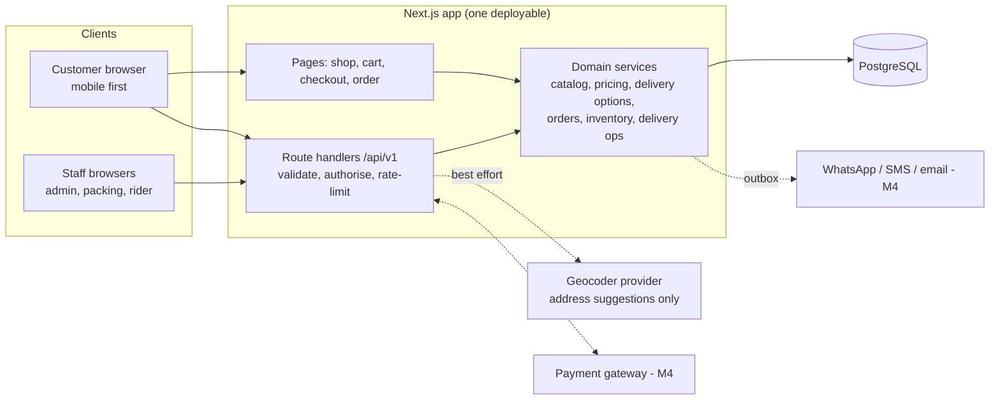
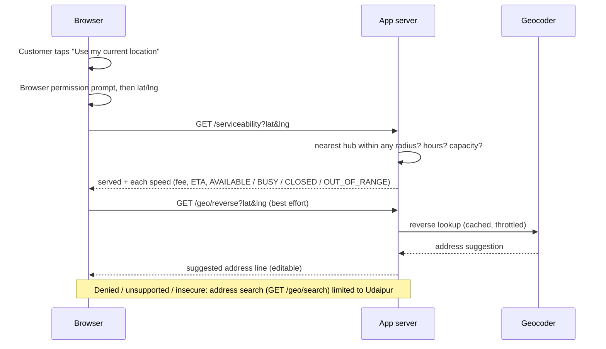
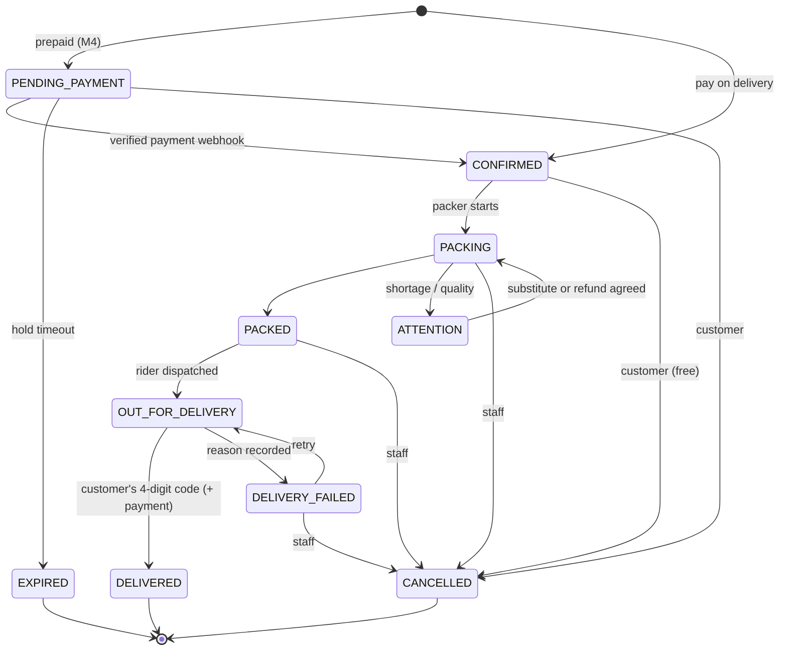
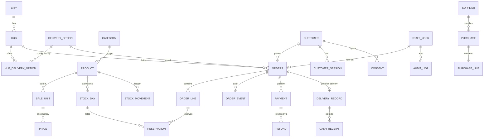

# Technical Architecture: Hari Haat delivery

> Status: v2 · 2026-10-24 · Reflects the code in `app/`. The van-era architecture is archived in `docs/archive-van-model/`.
> Principle: the simplest reliable architecture. One deployable Next.js app, one Postgres, a few managed services. No microservices, no Redis, no separate queue service.
> **[unverified]** = a cost/limit claim I have not confirmed from an official source.

## 1. Stack (as built)
| Layer | Choice | Notes |
|---|---|---|
| Language | TypeScript (strict) | One language end to end |
| App | Next.js 16 (App Router), React 19, Tailwind 4 | Cache Components left off (D-025); customer and admin in one app |
| Database | PostgreSQL 16+ | Constraints, row locks, advisory locks, partial unique indexes, append-only triggers |
| Data access | Drizzle ORM + SQL migrations (`app/drizzle/`) | Guarded `UPDATE … WHERE` for atomic counters |
| Validation | Zod at every boundary | Env, API bodies, query strings |
| Staff auth | DB sessions (token hash only), Argon2id, TOTP, lockout, rate limits | Roles: Owner, Ops manager, Procurement, Packer, **Rider**, Support |
| Customer auth | Phone OTP → 30-day cookie session; guest order links | OTP delivery provider: M4 |
| Jobs | Outbox table now; pg-boss worker in M4 | `expirePendingOrders` is implemented |
| Location | Browser Geolocation API → server-side haversine against hub radii | No external service for serviceability |
| Geocoding | `Geocoder` interface; dev uses Nominatim (OSM) | **Not for production** (policy: ~1 req/s, identifying User-Agent, caching; secondhand summary): choose a production provider (D-040) |
| Tests | Vitest unit + Postgres integration (185 tests) | Playwright E2E: not yet |
| CI | GitHub Actions file written, **not yet run** | |

## 2. System diagram

## 3. Location and serviceability flow

Rules: coordinates are sent only after the tap; serviceability needs no third party; the order stores the delivery position because the rider needs it; the waitlist stores ~1 km rounding; coordinates are not logged.

## 4. Order lifecycle

One table of allowed transitions (`order-state.ts`) with who may do each; compare-and-set on the current status; every transition writes an order event and an audit row.

## 5. Data model (ER)

Key rules enforced **in the database**, not just code: totals = subtotal − discount + fee; one captured payment per order; unique webhook event ids; unique order codes and idempotency keys; stock reserved ≤ published; hub hours valid; delivery fee/promise non-negative; 4-digit handover code; ledgers (stock movements, audit log, order events) are append-only (triggers).

## 6. Money and quantities
Paise and grams/pieces as integers (`lib/money.ts`, `lib/units.ts`). Line total = round(qty × unit price / unit size) once, with BigInt intermediate. Delivery fee is a separate integer. Totals are stored on the order and re-checked by a constraint.

## 7. Capacity and concurrency
- **Stock:** `UPDATE stock_day SET reserved = reserved + q WHERE published − reserved ≥ q` in the order transaction (0 rows → out of stock).
- **Hub capacity:** a transaction-scoped advisory lock per hub serialises order creation, then counts orders in active statuses per speed against `max_active_orders`. Under 12 concurrent Instant orders with limit 3, exactly 3 succeed (tested).
- **Idempotency:** the customer row is locked first; the idempotency key has a unique index; a loser of a race returns the winner's order.
- Trade-off: per-hub serialisation limits checkout throughput to roughly one order at a time per hub (milliseconds each): ample for one hub; revisit with multiple hubs or hundreds of orders per minute.

## 8. Security controls
Server-side `can()`/`requireStaff()` on every privileged action; Zod on every boundary; same-origin check on mutating requests + SameSite=Lax cookies; Argon2id, TOTP (mandatory for Owner/Ops/Procurement), lockout, replay protection; rate limits on login, OTP, checkout, geocoding, tracking; session and OTP tokens stored hashed; tracking tokens 192-bit; secrets only in env (separate `HH_` prefix avoids collisions with other projects on a machine); security headers; PII redaction in logs; no card data stored. **Delivery-specific:** the handover code is a proof of delivery with attempt limits; riders can act only on their assigned orders (service-level check, tested); tracking pages hide other customers' data, raw phone numbers and coordinates; the customer sees only the rider's first name while the order is out.

## 9. Notifications
Business events (`order.created`, `order.out_for_delivery`, `order.delivered`, `order.cancelled`, `order.delivery_failed`) are written to an outbox in the same transaction as the change. A worker (M4) sends WhatsApp/SMS/email through a provider interface. Transactional and promotional messages are separated by recorded consent. Development OTP is printed to the server console and refused in production.

## 10. Deployment (open decision D-004)
Container on an India-region host with a managed Postgres that includes point-in-time recovery, or a PaaS with a managed DB. Do **not** use a free tier without backups. HTTPS is mandatory in production: the browser Geolocation API refuses to run on insecure origins (localhost is exempt). Environments: local (private cluster on port 5433), staging (test keys), production. Production guards: `OTP_PROVIDER=console` and `GEOCODER_PROVIDER=nominatim` are refused when `NODE_ENV=production`.

## 11. Estimated infrastructure cost [E, unverified]
App hosting ₹1,500-6,000 · managed Postgres with PITR ₹1,500-5,000 · object storage/CDN ₹200-800 · monitoring ₹0-2,000 · geocoding: free tier only in development; production provider cost depends on volume (budget ₹0-3,000/month at pilot scale) · WhatsApp utility messages ~₹0.12-0.15 each [V, secondary] ≈ ₹1-1.5 per order with four messages · payment gateway ≈ 2%+GST of online sales [unverified] · domain/SSL ~₹100. **Fixed ≈ ₹5,000-17,000 per month.**

## 12. Scaling path (only when numbers demand)
One app instance + one Postgres is enough for hundreds of orders per day. Next: second app instance, read replica for reports, edge rate limiting. Multi-hub: `hub_id` is on orders already; add per-hub catalogue stock (stock_day per hub) and nearest-hub selection (already implemented). Multi-city: `city` table exists. Introduce Redis, a queue service or a warehouse only if measured need appears.

## 13. Future hooks
Stable `/api/v1` JSON API (a mobile app or a voice agent can reuse it); the voice agent would call deterministic tools (search, price, stock, delivery options, create draft order, confirm with a server-issued token) and never decide prices, stock or payment itself.
