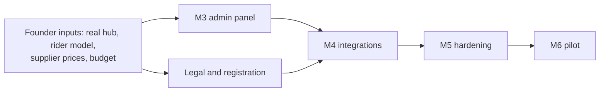

# Execution Roadmap: Hari Haat delivery

> Status: v2 · 2026-10-24 · Rewritten after the pivot to hub delivery. Effort figures are ideal person-weeks for one experienced engineer [E, ±40%]. The van-model roadmap is archived in `docs/archive-van-model/`.

## Where we are
| Milestone | State |
|---|---|
| **M1 Foundation** | Done: schema, staff auth + TOTP, RBAC, audit, rate limits, money/units libraries, UI kit |
| **M2 Customer ordering (delivery)** | **Done and verified locally** (185 automated tests; browser-checked): location detection + address search, serviceability by distance/hours/capacity, three speeds with fees, bilingual catalogue and search, cart, OTP checkout (pay on delivery), order page with delivery code, cancel, My orders, waitlist, policy page; **plus the delivery back-end services** (assign rider, dispatch, proof of delivery with code, cash/UPI record, failed delivery, staff cancel) tested but without screens |
| **M3 Operations + admin panel** | **Done and verified locally** (216 tests): dispatch board, orders, packing, rider screen, catalogue, stock, cash, reports, settings, staff |
| M4 Integrations | **Planned** (`M4_PLAN.md`): costs, approvals and order of work written; approved. **Step 1 done** (message worker, fake channel). Nothing paid or registered |
| M5 Hardening | Not started |
| M6 Pilot launch | Blocked on legal registrations (D-023) and a real hub |

## M3: Operations and the admin panel (you run the day from here) ≈ 5-6 weeks
Build in this order, each verified end to end:
1. **Dispatch board (live):** orders by status and speed, promised-by countdowns, late flags, busy indicators; assign rider; one-tap status moves with the permission checks already in the services. *(≈ 1 week)*
2. **Packing screen (tablet):** pick lists by order, weigh-in per line (BR-03 check), ATTENTION flow with substitute/refund choice. *(≈ 1 week)*
3. **Rider web app (phone):** my orders, navigate (map link), enter delivery code, record cash/UPI, failed-delivery reason. *(≈ 1 week)*
4. **Catalogue and price editor** (bilingual names, units, price history, sale prices, seasons, bundles) and **stock**: receiving, rejections, published quantity per day, wastage entry, daily count. *(≈ 1.5 weeks)*
5. **Settings screens:** hub hours and address, delivery speeds (fee, promise, minimum), radii and capacity per speed, pay-on-delivery cap, global minimum. *(≈ 0.5 week)*
6. **People and money:** staff management, cash-up per rider/day, simple reports (orders, GMV, contribution per order by speed/distance/basket, wastage, on-time %). *(≈ 1 week)*
**Done when:** a full day can be run in a rehearsal with staff-only orders and cash reconciles to the paisa.

## M4: Integrations ≈ 2-3 weeks (needs your approval before opening paid accounts)
Payment gateway (webhooks, refunds, reconciliation) · OTP and order messages through a real provider (WhatsApp authentication/utility templates or DLT SMS) · **production geocoder** decision and integration (D-040) · transactional email · pg-boss worker (expiry, reminders, late-order alerts).

## M5: Hardening ≈ 1.5-2 weeks
Playwright mobile E2E, security review, performance and accessibility audit, backups with a restore drill, monitoring/alerts, deployment + rollback runbook, load test of checkout, error/empty states.

## M6: Controlled pilot ≈ 4-6 weeks
Real hub, real catalogue, 2-day staff-only dry run, then friends-and-family orders with capped capacity; weekly review against the thresholds in `BUSINESS_PLAN.md` §10; decision memo.

## After (only with data)
Demand forecasting and buy-list suggestions · rider batching suggestions and route ordering · scheduled-for-later delivery · saved addresses and map pin confirmation · promos and loyalty · customer live-rider map (only if it reduces support load) · third-party rider partner integration · B2B ordering for hotels/restaurants · mobile app · AI voice ordering agent (deterministic tools over this API).

## Critical path

**Founder inputs that unblock the most:** the real hub address and lease, a rider quote or payroll plan, real mandi buy prices and shelf prices, whether to keep ₹0 minimum order, which production geocoder, and the legal-registration path.

## Definition of done (every milestone)
Features verified by automated tests or a recorded manual E2E check (not "code exists"); files changed; known limitations; security notes; operational dependencies; remaining tasks; decisions needed.
