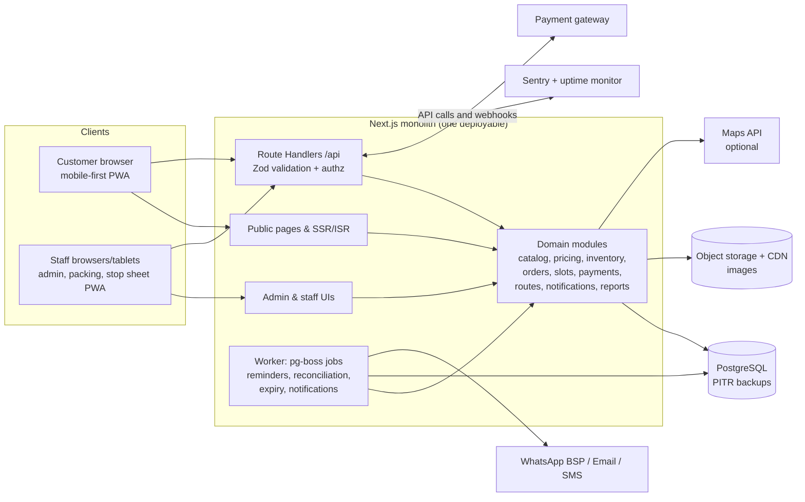
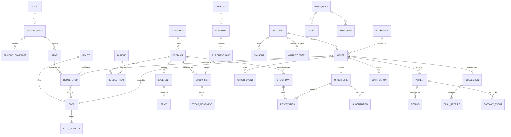
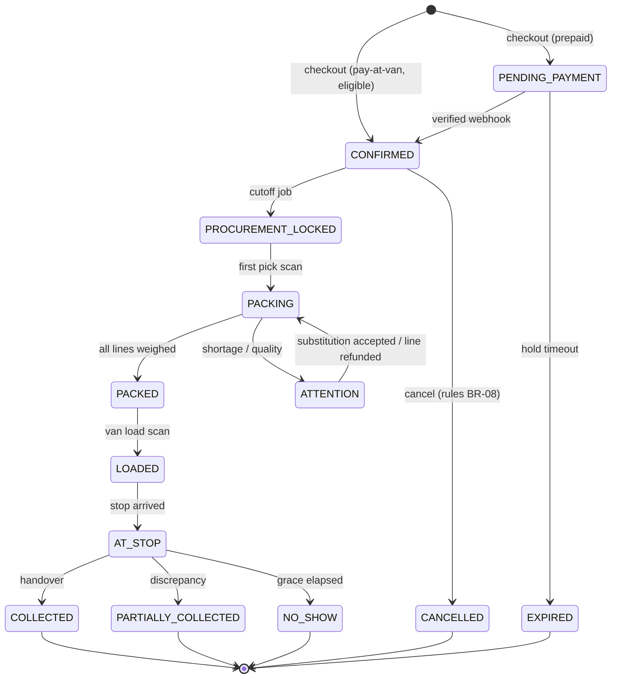
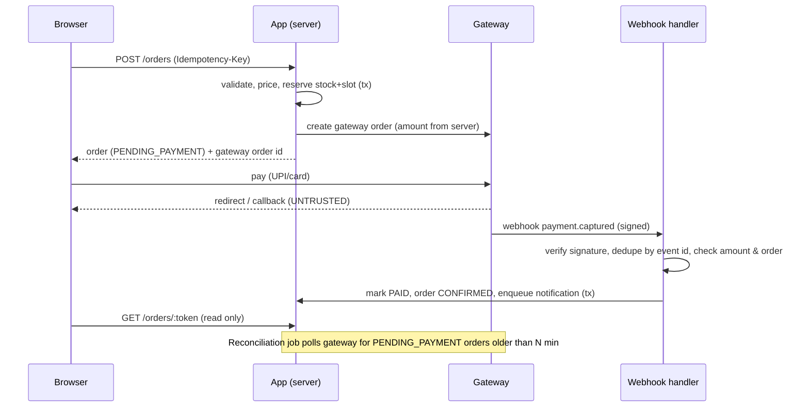

# Technical Architecture

> Status: DRAFT v0.1 · 2026-10-23 · **Repository inspected: `D:\SU` is empty and not a git repository. No stack to reuse, so this is a greenfield proposal.**
> Principle: *the simplest reliable architecture that satisfies the MVP.* One deployable app, one Postgres database, a handful of managed services. No microservices, no Redis, no Kafka.
> Items tagged **[unverified]** are cost/feature claims I have not confirmed from an official source this session.

## 1. Recommended stack

| Layer | Choice | Why | Alternatives considered |
|---|---|---|---|
| Language | TypeScript (strict) end-to-end | One language, shared Zod schemas, type-safe money/quantity types | Python/Django (strong admin, but two-language stack for a web UI) |
| App framework | **Next.js (App Router) monolith** (React Server Components, Route Handlers, Server Actions for non-critical forms) | SEO-friendly public pages, one codebase for customer + admin, easy hiring | Remix/SvelteKit (fine, smaller hiring pool); separate NestJS API (premature) |
| Styling/UI | Tailwind CSS + a small in-house component set (shadcn/ui-style primitives, Radix for a11y) | Fast, accessible, consistent customer + staff UI | MUI (heavier) |
| Database | **PostgreSQL** (managed, with point-in-time recovery) | Transactions, row locks, constraints, JSONB, partial indexes | MySQL (OK), Firebase/Mongo (weak for ledger/transactions) |
| Data access | **Drizzle ORM + drizzle-kit migrations** (SQL files in `app/drizzle/`), with guarded `UPDATE … WHERE` statements inside transactions for atomic stock/slot counters. *Changed from Prisma during Milestone 1 (D-005): no code-generation step, closer to SQL, and the concurrency-critical statements read naturally.* | Type-safe schema in TS; explicit SQL for concurrency-critical paths | Prisma (heavier codegen/driver-adapter setup) |
| Validation | Zod at every boundary (API, forms, webhooks, env) | Single schema source | Valibot |
| Auth (staff) | Server-side sessions in Postgres (HttpOnly, Secure, SameSite=Lax cookie), argon2id passwords, TOTP 2FA mandatory for Owner/Ops/Procurement, login rate limit + lockout | Simple, revocable, no JWT pitfalls | Hosted IdP (Clerk/Auth0, adds recurring cost and vendor lock for a 5-person staff) |
| Auth (customer) | **Phone OTP**, guest checkout; optional lightweight account = verified phone; signed unguessable order-tracking tokens | Matches Indian behaviour; avoids passwords | Email/password (poor conversion) |
| Background jobs | **pg-boss** (Postgres-backed queue/cron) in a worker process or scheduled route | No Redis; transactional enqueue; retry; good enough for <100k jobs/day | BullMQ+Redis (not needed), platform cron only (no retries) |
| Payments | A single Indian gateway (**Razorpay is the leading candidate; Cashfree / PhonePe PG are alternatives**), subject to merchant approval | UPI-first, webhooks, refunds API | See §9 |
| Notifications | Provider-agnostic `Notifier` port; email via transactional-email service; WhatsApp via a Meta-approved Business Solution Provider; SMS only if DLT registered **[?]** | Swap providers without touching domain code | Direct Meta Cloud API |
| Object storage/images | S3-compatible bucket + CDN; Next image optimisation or pre-generated variants | Product photos, GRN photos | Cloudinary (easy, usage-priced) |
| Maps/routing | Phase 1: **plain map links**; Phase 1.5: Google Routes *Compute Route Matrix* for travel times (cache results) | Free caps reported: Essentials routes/matrix 10,000 events/mo; Fleet Routing 1,000 events/mo then ~$30 per 1,000 **[V, secondary; verify on Google pricing page]**. Fleet Routing not needed for 5 stops | OpenRouteService/OSRM (self-host; more ops) |
| Observability | Structured JSON logs (pino) + Sentry (errors) + uptime ping + DB metrics from provider | Cheap and enough | Datadog (cost) |
| Testing | Vitest (unit/integration against real Postgres via Testcontainers), Playwright (E2E + mobile viewport), k6 or a script for stock-race tests | Mirrors PRD test matrix | Jest |
| CI/CD | GitHub Actions: typecheck, lint, tests, build, migration dry-run, deploy on tag | | |

## 2. System architecture



**Module boundaries** (a "modular monolith": folders with explicit public interfaces, no cross-module DB writes):

```
src/
  modules/
    catalog/    products, units, prices, bundles
    inventory/  stock_day, lots, movements, reservations
    orders/     order aggregate, state machine, cancellations
    slots/      areas, stops, slot capacity, cutoffs
    routes/     daily routes, stop events
    payments/   gateway adapter, ledger, refunds, reconciliation
    fulfilment/ packing, collection, substitutions
    people/     customers, staff, roles, consent
    notify/     notifier port + adapters, templates
    reports/    SQL views, dashboards
  app/ (Next.js routes)    lib/ (money, units, ids, logger)    jobs/
```

All money is `Paise` (branded `bigint`/integer), all quantity `BaseUnits` (grams or pieces, integer). Conversions live in `lib/money.ts` and `lib/units.ts` with property-based tests.

## 3. Frontend

- Server-rendered public pages (home, category, product, society/stop pages) with ISR; cart and checkout are client components talking to the API.
- Cart: stored in `localStorage` as `{productId, unitId, qty}` only (no prices); server re-prices on every call. Verified customers get a server cart (to reorder across devices) in P1.
- Checkout is a single-page stepper; every step validated by the same Zod schema on server.
- Staff UIs: `/admin` (desktop), `/pack` (tablet), `/stop/[routeStopId]` (phone PWA, cached stop sheet, queued writes in IndexedDB, P1).
- Design tokens per PRD §12. Accessibility via Radix primitives, tested with axe in Playwright.
- i18n-ready (`next-intl`), English first.

## 4. Backend and API design

- REST-ish Route Handlers under `/api/v1`, one handler per command, each:
  1. authenticate → 2. authorize (policy function: `can(user, action, resource)`) → 3. Zod parse → 4. call domain service in a transaction → 5. emit audit/outbox → 6. return typed result.
- **Idempotency:** `Idempotency-Key` header required for `POST /orders`, refunds and payment-initiation; table `idempotency_keys(key, scope, request_hash, response, created_at)` with unique `(scope, key)`.
- **Rate limiting:** token bucket by IP + phone on OTP, checkout, serviceability, login, and tracking endpoints, in Postgres (small scale) with an upgrade path to an edge/WAF limiter.
- **Error format:** problem+json with stable error codes (`AREA_NOT_SERVED`, `SLOT_FULL`, `OUT_OF_STOCK`, …).
- Internal events: transactional **outbox** table consumed by the worker (notifications, analytics). No external event bus.

## 5. Database design

### 5.1 Entity relationship diagram



### 5.2 Key tables (selected columns)

```text
product(id, category_id, name, name_local, description, weight_model[FIXED_PACK|APPROX_PIECE|LOOSE_WEIGHT],
        base_unit[GRAM|PIECE], tolerance_pct, storage_note, origin_note, active, season_start, season_end)
sale_unit(id, product_id, label, base_qty, min_qty, max_qty, step_qty, active)   -- e.g. "500 g" base_qty=500
price(id, sale_unit_id, price_paise, sale_price_paise, valid_from, valid_to, created_by)
stock_day(product_id, service_date, published_qty, reserved_qty, received_qty, packed_qty, ...)  -- PK(product_id, service_date)
stock_lot(id, product_id, purchase_line_id, received_date, qty_received, unit_cost_paise_per_base, grade, expiry_hint)
stock_movement(id, lot_id, product_id, service_date, type, qty_base, ref_type, ref_id, reason, actor_id, created_at) -- append-only
slot(id, route_id, service_date, cutoff_at, window_start, window_end, status)
slot_capacity(slot_id, max_orders, used_orders, max_pack_minutes, used_pack_minutes,
              max_load_units, used_load_units, max_dwell_seconds, used_dwell_seconds)
order(id, public_code, customer_id, slot_id, route_stop_id, fulfilment[COLLECT|DELIVER],
      status, subtotal_paise, discount_paise, fee_paise, total_paise, payment_mode,
      idempotency_key, pickup_code_hash, tracking_token_hash, policy_version, created_at)
order_line(id, order_id, product_id, sale_unit_id, qty_ordered_base, unit_price_paise, line_total_paise,
           qty_packed_base, packed_weight_g, status, notes)
payment(id, order_id, provider, provider_order_id, provider_payment_id, status, amount_paise, method, created_at)
gateway_event(id, provider, event_id UNIQUE, signature_ok, payload_json, processed_at)
refund(id, payment_id, order_id, amount_paise, reason, status, provider_refund_id, requested_by, approved_by)
cash_receipt(id, collection_id, method[CASH|UPI], amount_paise, reference, collected_by, created_at)
audit_log(id, actor_id, action, entity, entity_id, before_json, after_json, ip, created_at)
```

Constraints that must be in the database (not only code): `CHECK (qty >= 0)` on counters; `UNIQUE (provider, event_id)`; `UNIQUE (idempotency scope, key)`; FK integrity; partial unique index so a customer cannot have two payments `CAPTURED` for one order; `reserved_qty <= published_qty` check; immutability triggers or revoked `UPDATE/DELETE` on ledger tables for the app role.

### 5.3 Inventory reservation (no overselling)

Fresh produce is sold per **service date**, so availability lives in `stock_day`. Reservation is one atomic statement per line inside the order transaction:

```sql
UPDATE stock_day
SET reserved_qty = reserved_qty + :qty
WHERE product_id = :pid AND service_date = :d
  AND published_qty - reserved_qty >= :qty;       -- 0 rows updated => OUT_OF_STOCK
INSERT INTO stock_movement (...type='RESERVED'...);
```

The same pattern guards `slot_capacity` counters (`used_orders + 1 <= max_orders AND used_pack_minutes + :m <= max_pack_minutes ...`). Sorting lines by `product_id` before updating avoids deadlocks. A test fires N parallel checkouts at M units and asserts exactly M successes.

`published_qty` is a *planned* figure set by procurement from supplier commitments; when goods are received/inspected, `received_qty` is compared against `reserved_qty` → shortages flagged. Received-but-uninspected goods do not add to `published_qty` until accepted.

### 5.4 Order lifecycle



Transitions are defined once in a table (`from, to, allowed_roles, guard, side-effects`) and enforced in the domain service; each transition inserts an `order_event`.

### 5.5 Payment lifecycle



Key rules: amount compared to server total; currency INR; mismatch → hold for review, no confirm. Refunds are created as `refund` rows (REQUESTED → APPROVED → SENT → SETTLED/FAILED), sent through the gateway API with idempotency, and reconciled against webhook confirmation. Pay-at-van receipts are `cash_receipt` rows created at handover.

### 5.6 Slots, cutoffs, routes

- `slot` has an absolute `cutoff_at`; a default rule (e.g., 21:00 D-1) pre-fills it when ops publishes a day; exceptions require a role with `slot.override` and are audited.
- `slot_capacity` counters (§5.3) store the **composite** limits from BR-07.
- Route planning: ops chooses stops and order; the app stores `route_stop(sequence, planned_arrival, window_start, window_end, dwell_seconds)`; updates trigger a diff → affected-orders → notifications job.
- Stop events (`ARRIVED`, `DEPARTED`, `DELAYED`) are single button taps by the driver — **no live GPS in MVP**.

## 6. Administration

- Role→permission matrix stored in code (versioned) and checked server-side by `can()`; table of staff-role assignments in DB. Example permissions: `product.write`, `price.write`, `stock.adjust`, `purchase.write`, `order.read`, `order.cancel`, `refund.create(≤₹300)`, `refund.approve`, `route.write`, `collection.write`, `report.finance`, `staff.manage`, `slot.override`.
- Every privileged mutation writes `audit_log` with before/after.
- Admin UI built from the same Next.js app with shared components; tables with server-side pagination, CSV export, printable pick lists/labels (HTML print stylesheets + PDF generation via headless rendering later if needed).

## 7. Notifications

- `Notifier` port: `send(templateId, to, params, channel)` with adapters for email, WhatsApp BSP, SMS. Templates versioned. Transactional messages vs. promotional strictly separated; promotional only with a recorded `consent`.
- Outbox → worker → provider with retries/backoff; delivery status webhooks stored; fall back WhatsApp→SMS→email by customer preference and cost.
- WhatsApp per-message pricing in India (reported, conflicting): utility ≈ ₹0.115–0.145, marketing ≈ ₹0.86–1.09 **[V, secondary; check Meta rate card]**. Budget rule: ~4 utility messages per order ≈ ₹0.5–0.6 per order [A].
- OTP: WhatsApp authentication template or SMS (DLT registration required in India for SMS, to be confirmed **[?]**).

## 8. Security controls

| Control | Detail |
|---|---|
| Authz | Deny-by-default `can()` policies on server; object-level checks (e.g., customer tracking token bound to one order); automated authorization-matrix test |
| Input | Zod everywhere; parameterised SQL only; output encoding (React) + CSP |
| Sessions | HttpOnly, Secure, SameSite=Lax cookies; rotating session IDs; idle + absolute timeouts; server-side revocation |
| CSRF | SameSite + CSRF token (double submit) on cookie-authenticated mutations; Origin check |
| Brute force | OTP attempt limits, per-phone/IP rate limits, staff lockout, CAPTCHA only if abuse appears |
| Webhooks | HMAC signature verification with raw body, timestamp tolerance, event-ID dedupe, amount/order cross-check, allow-listed IPs if provider supports |
| Secrets | Env vars from the host's secret store; `.env*` git-ignored; secret scanning in CI; separate keys for test/live |
| PII | Minimal: name, phone, optional email/address; encrypted at rest by DB provider; no PII in logs (structured redaction); tracking links tokenized; pickup codes stored hashed |
| Payments | Gateway-hosted checkout; no card data touches our servers/DB (PCI scope minimized) |
| Dependencies | Lockfile, Dependabot/Renovate, `npm audit` in CI |
| Admin | TOTP 2FA, IP/device logging, audit logs, separate admin hostname/path |
| Headers | HSTS, CSP, X-Content-Type-Options, frame-ancestors none |
| Abuse | Order velocity checks, no-show scoring, promo abuse limits |
| Privacy | Consent log, data export/delete workflow, retention schedule (DPDP substantive duties expected from 13 May 2027 per secondary sources **[V, secondary]**; counsel to confirm) |

## 9. Payments: gateway choice criteria

Evaluate on: merchant onboarding for grocery/produce; UPI success rate and UPI-intent support on mobile; refund API and SLAs; webhooks & signature scheme; settlement T+N; dashboard/reconciliation exports; price. Razorpay's older India pricing posts show **~2% + 18% GST (≈2.36%)** for domestic cards/UPI/netbanking, but the live India page could not be confirmed this session (a third-party tracker reports the public pricing page switched to US pricing) **[unverified, ask sales]**; note that government zero-MDR on UPI/RuPay debit means gateways monetize via "platform fees" — negotiate. Model assumes 2.36% on prepaid orders.

Design: `PaymentGateway` interface with a single adapter at first; payment *method* configurable per fulfilment mode; no provider-specific types leak outside `modules/payments`.

## 10. Deployment architecture

Two sensible options; the choice is DECISIONS D-004 (no paid services will be registered until you approve).

| Option | Setup | Pros | Cons | Indicative cost [unverified, ₹/month] |
|---|---|---|---|---|
| **A. PaaS (Vercel-style) + managed Postgres** | Next.js on Vercel; managed Postgres (Neon/Supabase/other) | Fastest to ship; previews; zero server admin. Vercel Pro ≈ $20 per seat/month plus usage **[V, secondary]** | Usage-based surprises; worker/cron limits; DB region/latency to confirm for India | ₹3k–10k |
| **B. Single container host in an India region + managed Postgres** | Docker image on a small VM/App service in Mumbai-class region; managed Postgres with PITR; worker as a second process | Predictable cost; low latency; one place for web+worker | You own the runbook (deploys, TLS, patching) | ₹4k–12k |

**Recommendation:** start with **B-lite** (managed container service or one small VM + managed Postgres in an India region) *if* you or a hired engineer is comfortable with ops; choose **A** if you want zero ops and accept variable cost. Either way: CDN in front, staging environment, infrastructure described in a short `docs/runbook.md`, and no region choice finalized before checking provider India availability **[unverified]**.

Environments: `local` (docker-compose Postgres), `staging` (test gateway keys), `production`. Config only via env vars validated by Zod at boot.

## 11. Backup and recovery

- Managed Postgres with daily snapshots + **point-in-time recovery** (≥ 7 days); verify it is included in the chosen plan (free tiers often exclude it) **[unverified]**.
- Weekly logical dump to separate object storage (different provider/account).
- Object storage versioning for product images.
- **Restore drill** before launch and quarterly: restore into staging, run reconciliation SQL, record time taken. Target RPO ≤ 15 min, RTO ≤ 2 h.
- Migration policy: forward-only, reviewed, run in CI against a copy; rollback by restore or compensating migration; never destructive migrations in the same deploy as code that depends on them.

## 12. Logging and monitoring

- pino JSON logs with request IDs; redaction list (phone, email, address, tokens, OTP).
- Sentry for exceptions (scrub PII).
- Uptime checks on `/healthz` (DB + queue) with SMS/call alert to the owner.
- Business alerts (via worker): webhook failures, payments stuck `PENDING` >15 min, slot nearing capacity, stock below reservation, queue backlog, nightly reconciliation mismatch.
- Basic dashboards from DB views; no separate analytics warehouse yet.

## 13. Expected infrastructure cost (MVP, ₹/month, **[E] unless noted; none verified as quotes**)

| Item | Estimate | Note |
|---|---|---|
| App hosting | 1,500–6,000 | Option A/B |
| Managed Postgres (with PITR) | 1,500–5,000 | Don't use a plan without backups |
| Object storage/CDN | 200–800 | Photos small |
| Email | 0–1,000 | Low volume |
| WhatsApp messages | ~0.5–1/order utility **[V, secondary]** | 1,500 orders/month ≈ ₹1,000–1,500 |
| Payment gateway | ~2.36% of prepaid GMV **[unverified]** | Variable, in unit economics |
| Error monitoring | 0–2,000 | Free tier acceptable early |
| Maps API | 0–500 | Within free caps **[V, secondary]** |
| Domain, SSL | ~100 | |
| **Total fixed** | **≈ ₹5,000–15,000** | Matches ₹6,000 "software" line in UNIT_ECONOMICS (optimistic) |

## 14. Scaling strategy (only when numbers demand it)

1. **Now→~1,000 orders/day:** single app instance (2 for redundancy), one Postgres, indexes tuned, read-heavy catalog cached with ISR.
2. **Next:** read replica for reports; add queue worker instance; CDN for images; move rate limiting to the edge.
3. **Multi-city:** `city_id` on all operational tables from day 1 (cheap now, expensive later); per-city catalog/pricing overrides; per-city ops dashboards.
4. **Only if proven necessary:** Redis for rate limits/hot counters, a separate service for notifications or routing, a warehouse for analytics.

## 15. Architecture questions investigated

| Question | Decision for MVP | Revisit when |
|---|---|---|
| Separate backend service? | No (modular monolith) | A second client (native app) needs it; API versioning already planned |
| Redis/cache? | No | Rate-limits or hot counters stress Postgres |
| Dedicated job queue? | pg-boss on Postgres | >100k jobs/day |
| Real-time GPS tracking? | No (stop-event taps) | Delay complaints high or measurable no-show reduction |
| Route optimization software? | No (manual order + travel-time matrix) | >8 stops/route or >3 vehicles |
| Advanced analytics infra? | No (SQL views) | Dashboards slow or data science needs |
| Event-driven architecture? | Only internal outbox | Multi-service future |

## 16. Future-proofing hooks (cheap now)

- Stable `/api/v1` JSON API with OpenAPI generated from Zod → reusable by a mobile app and a **voice agent** that calls deterministic tools: `searchProducts`, `getPrice`, `checkStock`, `listSlots`, `createDraftOrder`, `confirmOrder(requires customer confirmation token)`. The LLM never owns inventory, prices or payment state.
- `customer.channel_ids` and `consent` support WhatsApp ordering later.
- Feature flags table for home delivery, early-slot requests, walk-up sales, promos.
