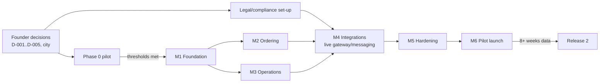

# Execution Roadmap

> Status: DRAFT v0.1 · 2026-10-23 · Effort estimates are for one experienced full-stack engineer working with a part-time founder/ops lead, expressed in **ideal person-weeks** [E]. They are rough (±40%) and will be re-baselined after Milestone 1.
> **Nothing below is started. Implementation waits for your approval of the plan and answers to the blocking questions in `DECISIONS.md`.**

## Status (updated 2026-10-24)

Founder decisions (DECISIONS D-018..D-027): city Udaipur; **build the full production-ready site** (Phase 0 pilot runs in parallel through the founder's own supplier/vehicle/society contacts, it no longer gates the build); admin panel is first-class; UI in English, product names in English + Hindi.

| Milestone | State |
|---|---|
| M1 Foundation | **Done and verified locally** (81 automated tests passing, typecheck/lint/build clean). Not done: CI has not run on GitHub (no repo yet); customer OTP delivery provider; `/admin/staff` management screen (staff are created by the seed script until M3). |
| M2 Customer ordering | **Done and verified locally** (see `app/README.md`). In: home, pincode serviceability, slot picker, waitlist, bilingual search, catalogue/product pages, cart, phone-OTP checkout (pay-at-van), order tracking page with pickup QR, customer cancel, "my orders", draft policy page. Not in: product bundles (CAT-08, moved to M3 with the admin screen that defines them), promo codes (P1), online payment (M4), real notifications (M4), real product photos, home delivery, early-slot requests. Browser-checked on a 375 px phone viewport and desktop; no automated browser (Playwright) tests yet. |
| M3 Operations / admin panel | Not started |
| M4 Integrations | Not started; needs approvals before any paid account is opened |
| M5 Hardening | Not started |
| M6 Pilot launch | Blocked on legal registrations (D-023) |

## Phase overview

| Phase | Name | Duration [E] | Software? | Gate to next |
|---|---|---|---|---|
| 0 | Concierge validation pilot | 4–6 weeks | None / spreadsheet + WhatsApp + UPI | Pilot thresholds met (BUSINESS_PLAN §11/12) |
| 0.5 | Compliance & set-up | In parallel, 2–6 weeks | None | Licences, entity, gateway approved |
| 1 | Website MVP (Milestones 1–5) | 10–14 weeks | Yes | Dry-run passed, test matrix green |
| 2 | Controlled pilot launch (Milestone 6) | 4–6 weeks | Yes | Contribution/route trending to ≥ 0 |
| 3 | Operational optimisation (Release 2) | 8–12 weeks | Yes | Stable ops; ≥ 8 weeks data |
| 4 | Mobile app (Release 3) | 10–16 weeks | Yes | Retention justifies |
| 5 | AI voice agent (Release 4) | 8–12 weeks | Yes | Stable APIs, order volume |

If you disagree with Phase 0 and want to start building immediately, the build plan below still applies, but you would be spending ~₹3–6 lakh of build effort before knowing whether orders-per-stop supports the van (see UNIT_ECONOMICS). I recommend against it. Decision D-001.

## Phase 0: Concierge validation (no code)

| Item | Detail |
|---|---|
| Deliverables | Landing page (static), Google Form/Sheet, WhatsApp Business, UPI collection, price-basket benchmark, supplier trials, 2–3 pilot stops |
| Dependencies | City/neighbourhood choice; a vehicle (hired); basic FSSAI/GST advice **before** selling [?] |
| Testing | Dry-run of the packing/handover workflow with staff only |
| Effort | ~3 person-weeks founder time + ₹60k–1.5 lakh |
| Risks | Legal exposure by selling before registrations [?]; ops chaos with manual systems |
| Done when | Thresholds in BUSINESS_PLAN §11 met for 2 consecutive weeks, or a pivot decision recorded |

## Phase 1: Website MVP (Milestones 1–5)

| Milestone | Scope | Effort [E] | Dependencies | Tests required | Completion criteria |
|---|---|---:|---|---|---|
| **M1 Foundation** | Repo, CI, env validation, Docker Postgres, schema + migrations, auth (staff sessions + TOTP; customer OTP stub), RBAC `can()`, audit log, design tokens/UI kit, money/unit libraries | 2–2.5 w | Stack approved (D-003/004/005), hosting decision | Unit: money/units property tests; authz matrix; migration test | `npm test` green; seeded dev DB; README with setup; roles enforced |
| **M2 Customer ordering** | Home, serviceability, catalog, search/filter, product page, cart, slot selection, checkout (pay-at-van path + prepaid stub), order confirmation + tracking page | 3–3.5 w | Catalog data & photos, copy, brand direction (D-012) | Integration: pricing server-side, unit rules, slot full, area not served, idempotency; Playwright mobile E2E; axe | AC-SVC/PRICE/UNIT/IDEMP pass; Lighthouse mobile budget |
| **M3 Operations** | Admin shell, product/price admin, stock_day + lots + ledger, GRN, buy list, shortage + substitution, order mgmt + state machine, pick lists & labels, route/stop mgmt, driver stop sheet + collection, cash/UPI records, daily close/reconciliation | 4–4.5 w | Ops SOPs from Phase 0 | Concurrency/oversell test; state-machine tests; reconciliation tests; role tests | AC-STOCK/AUTHZ/CANCEL/SUB/PICKUP/RECON/ROUTE pass; ops walk-through |
| **M4 Integrations** | Gateway (test mode → live after approval), webhooks, refunds, reconciliation job, notifier (email + WhatsApp/SMS), reminders, delay broadcast, image storage | 2–2.5 w | Gateway & messaging approvals (paid accounts only after your OK) | Forged/duplicate/late webhook tests; refund flows; provider-fail simulation | AC-PAY pass in sandbox; live smoke tests with small real amounts |
| **M5 Hardening** | Security review, performance pass, a11y audit, error/empty states, backup/restore drill, monitoring/alerts, production config, deploy + rollback runbook | 1.5–2 w | Hosting live | Full test matrix (PRD §13), load test of checkout, restore drill, pen-test checklist | All P0 tests pass; restore drill documented; rollback rehearsed |
| **Total** |  | **≈ 13–15 w** |  |  |  |

Parallel non-code work: legal/policy pages (terms, refund, privacy, grievance), product photography, supplier onboarding, staff training.

## Phase 2: Controlled pilot (Milestone 6)

| Task | Done when |
|---|---|
| Seed catalogue (top 30–40 SKUs), configure 1 area, 4–5 stops, cutoffs | Staff can place/fulfil an internal order end-to-end |
| 2-day dry run with staff orders | Zero unreconciled variance |
| Test cancellations/refunds with live gateway (₹ small) | Refund received; ledger matches |
| Controlled launch: 3 days/week, capped orders per slot | Weekly review shows metrics vs thresholds |
| Weekly growth + ops review | Documented decisions |
| Exit criteria | See BUSINESS_PLAN §12 |

## Phase 3: Release 2: Operational optimisation (only after data)

Demand forecasting (simple moving averages first), procurement recommendations by supplier, route-matrix assistance/optimisation if needed, wastage analytics, loyalty/referral automation, saved + recurring baskets (customer-authorised), improved CRM, driver app improvements (offline write queue, queue management), automated gateway reconciliation.

## Phase 4: Release 3: Mobile app

Evaluate only if mobile web retention is the bottleneck. Prefer PWA first; cross-platform (React Native/Expo) reusing `/api/v1`; push notifications; no new business logic in the client.

## Phase 5: Release 4: AI voice agent

Deterministic tools over the existing API; an LLM for speech understanding/dialogue only; explicit confirmation step with a server-issued confirmation token before `confirmOrder`; human escalation; transcripts retained per privacy policy. Evaluate Hindi/regional language accuracy and cost per call before launch.

## Critical path & dependencies

## Top delivery risks

| Risk | Mitigation |
|---|---|
| Scope creep from "nice" features (home delivery, loyalty, routing) | PRD deferral list; change control through DECISIONS |
| Gateway/WhatsApp/DLT approvals take weeks | Start applications early *after your approval*; sandbox first |
| Ops processes not ready when software is | Phase 0 produces SOPs; software mirrors them |
| Single-engineer bus factor | Docs, tests, simple stack |
| Hidden compliance requirements (FSSAI e-commerce licence, etc.) | Professional review in Phase 0.5 before any sale |
| Photo/content bottleneck | Start photography with first suppliers |

## Definition of done (every milestone)

Features listed with verification evidence (tests run + results), files/components changed, known limitations, security notes, operational dependencies, remaining tasks, decisions needed. A feature is "complete" only when verified by automated tests or a recorded manual E2E check. No placeholder buttons or mock data presented as working.
